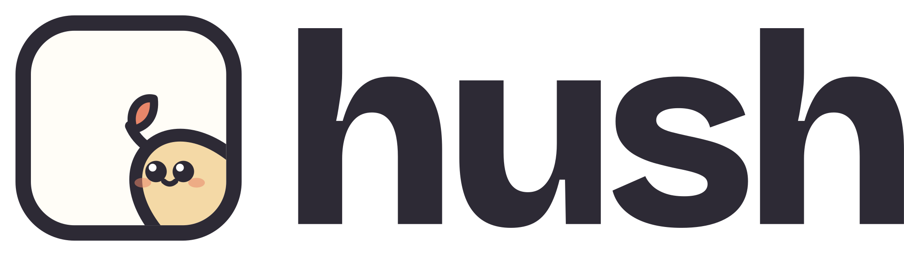
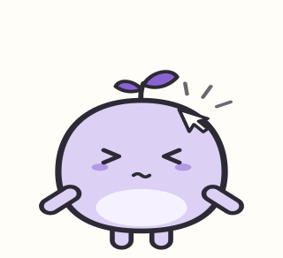
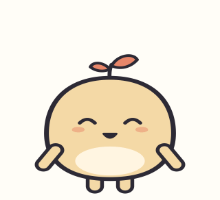
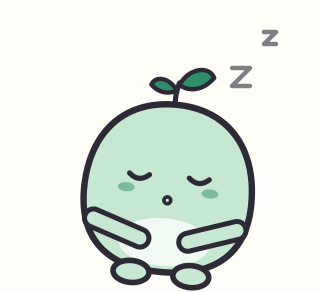
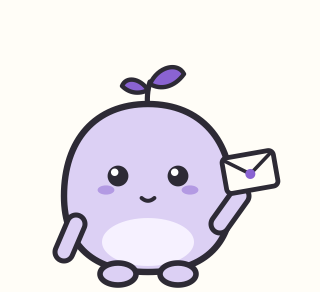
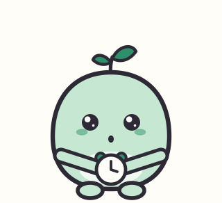
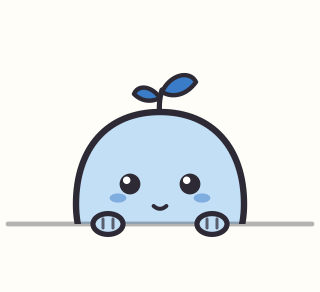
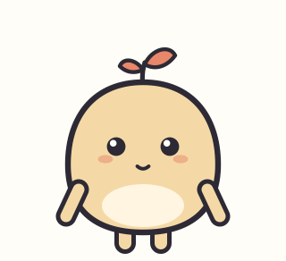
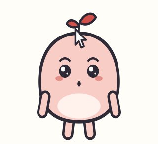
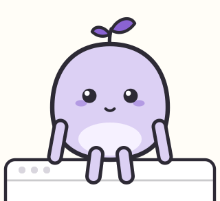

<p align="center">
  <picture>
    <source media="(prefers-color-scheme: dark)" srcset="assets/brand/lockup/hush-lockup-horizontal-on-dark.svg">
    
  </picture>
</p>

<p align="center"><strong>A small, silent friend at the edge of your Mac that only steps forward when something has earned it.</strong></p>

<p align="center">
  <a href="https://github.com/adityasshekhawat/hush/actions/workflows/test.yml"></a>
  
  <a href="LICENSE"></a>
</p>

<p align="center">
  
  
  
</p>

Hush lives at the bottom of your screen, peeking over the edge. It never makes a sound and never talks. It watches
your AI coding agents and your calendar, keeps quiet about what can wait, and uses body language for what can't.
At the end of the day it tells you how much it spared you: *"You got 4 things from me today. I held back 63."*

**Status:** pre-alpha. A native macOS app, free and open source, built from source for now.

## Why

Notifications treat every ping as urgent, so the important ones drown and the rest break your focus. Desktop pets
are cute but don't help. AI companions talk at you. Hush is the opposite of all three: a character with judgment
about **when not to show up**. Only your meetings, your VIPs and your own rules may interrupt you, never a model on
its own, and a daily cap (5 by default) keeps even those rare.

## What it does

<table>
<tr>
<td width="180"></td>
<td><strong>Watches your AI agents.</strong> Claude Code and Codex sessions, through hooks you approve. Hush thinks
while an agent works where you aren't looking, holds up an envelope when a long run finishes ("Claude finished in
hush · ran for 4m"), and perks up when one needs your OK. One click takes you back to its terminal. Quick runs you're
watching stay quiet.</td>
</tr>
<tr>
<td></td>
<td><strong>Remembers your meetings.</strong> From the Mac's Calendar (Google, Outlook and iCloud calendars you've
added work too): it holds a clock 10 minutes before and hurries in 2 minutes before. It's its own window, not a
notification, so Focus and Do Not Disturb don't hide it. <em>One-click join links are coming.</em></td>
</tr>
<tr>
<td></td>
<td><strong>Answers in place (⌘⇧H).</strong> One quick question, one answer card shaped to it (a formula, a command,
steps) with buttons that send it where you're working, like Excel or your terminal. Bigger questions open in
ChatGPT, Claude or Perplexity. Answers use your own Claude Code login (see below).</td>
</tr>
<tr>
<td></td>
<td><strong>Hand it to Hush.</strong> Copy some text and Hush's cheeks fill up. Click it, pick <em>Simpler</em>,
<em>Shorter</em> or <em>Bullets</em>, and it chews, then hands the result back on your clipboard. Paste, and the
cheeks blow out. Runs on your Mac with Apple Intelligence.</td>
</tr>
<tr>
<td></td>
<td><strong>Stays out of your way.</strong> It ducks while you type, disappears during calls, and is left out of
screen shares and screenshots. Pause it for 15 minutes, an hour or until tomorrow from the menu bar, or press
⌥⇧⌘H to put away whatever it's showing. Clicks pass straight through everywhere except Hush itself.</td>
</tr>
<tr>
<td></td>
<td><strong>Plays, but only when you're idle.</strong> Drag and fling it and it gets dizzy. It perches on your window
after a couple of quiet minutes, stretches in the morning, bobs along to music. Play never interrupts and never
counts toward the daily cap.</td>
</tr>
<tr>
<td></td>
<td><strong>Make it yours.</strong> Three bodies, five colours, eyes, toppers and a wardrobe of 45 pieces, all free.
Some rare pieces turn up on their own.</td>
</tr>
</table>

**Not yet:** mail. The Apple Mail extension is in progress; until it lands, mail is only simulated (Settings ▸
Developer). When it arrives, Apple's on-device model judges each mail on your Mac.

## What leaves your Mac

No Hush server, no account, no analytics, no crash reporting. Everything Hush learns and logs stays in
`~/Library/Application Support/Hush/`. These are the only times anything leaves the Mac, and each one starts with
something you do:

| When you… | What's sent | Where |
| --- | --- | --- |
| Press Return in Ask Hush (quick or code question) | Your question and the name of the app you were in. For a code question, Claude Code reads files in that repo, which you allowed first | Anthropic, through **your own** Claude Code login and usage |
| Press Return when Hush isn't sure where a question should go (Smart routing, on by default, Settings ▸ Ask Hush) | Your question, your allowed repos' names, how many sessions are running, the app you're in | Anthropic, through your Claude Code login |
| Click **Summarise** on a "While you were away" card | A short excerpt of that one session | Anthropic, through your Claude Code login |
| Run a browser task (beta, off by default) | The task, and what Claude does in your browser | Anthropic, through Claude Code and the Claude browser extension |
| Hand a question off ("open in ChatGPT / Claude / Perplexity") | The question, in the link that opens (from "hand it to Hush", only the instruction: you paste the text yourself) | The assistant you picked |

**Stays on the Mac:** your calendar (read through macOS); the Claude Code and Codex hooks, which send Hush only the
event, session id, folder, host app and terminal device; mail judging and "hand it to Hush", which use Apple's
on-device model when Apple Intelligence is on; transcripts for the digest (only if you turn it on); the clipboard,
which Hush reads only when you click it to rework what you copied.

Planned: quick answers and Summarise move to Apple's on-device model, and the remaining Claude features sit behind
one switch that's off until you turn it on.

## Install

There's no signed download yet, so Hush is built from source. A Mac that builds an app runs it without Gatekeeper
warnings.

**You need**
- macOS 15 or later
- Xcode, or the Command Line Tools with Swift 6.1 or later (`xcode-select --install`)
- Optional: Apple Intelligence on (macOS 26 or later, Apple silicon) for "hand it to Hush" and mail judging
- Optional: [Claude Code](https://claude.com/claude-code) for agent alerts (they use its hooks, no model calls) and
  for Ask Hush answers, which use your own Claude usage

```sh
git clone https://github.com/adityasshekhawat/hush.git && cd hush
./scripts/bundle.sh        # builds, installs to /Applications/Hush.app and opens it
```

Hush walks you through the rest: a look, a few tries, then Calendar and your Claude Code sessions, each optional.
Its data stays in `~/Library/Application Support/Hush/`.

## Things to try

- **Hover** over Hush: it pops up and waves. **Press and hold:** a pat.
- **Click it four times fast.** Then wait.
- **Copy a paragraph,** click Hush, pick *Shorter*, paste.
- **⌘⇧H** and ask "XLOOKUP in Google Sheets".
- **Drag it** onto the top edge of a window and let go.
- Start a long Claude Code run in another window and go do something else.
- Look at the menu bar panel at the end of the day: "63 held back today".

## How it works

- `Sources/HushCore`: the decision engine (rules, then a classifier, then quiet hours, the daily cap and focus) and
  everything else that can be tested without a Mac UI. Time is injected, storage is SQLite.
- `Sources/HushMac`: macOS adapters (Calendar, focus and call detection, Apple's on-device model, hooks).
- `Sources/Hush`: the app. The character is SVG art drawn in a small web view; cards are SwiftUI.
- `Sources/hushctl`: the tiny helper the Claude Code and Codex hooks run.

[`CLAUDE.md`](CLAUDE.md) is the code map, [`docs/features.md`](docs/features.md) lists everything Hush does,
[`docs/decisions.md`](docs/decisions.md) records why, and [`docs/performance.md`](docs/performance.md) has measured
CPU and memory. Changes are in [`CHANGELOG.md`](CHANGELOG.md).

## Contributing

Code, ideas and **art** are welcome. Hush needs hats, outfits, props, buddies and seasonal pieces drawn to fit its
bodies: see [`CONTRIBUTING.md`](CONTRIBUTING.md). The bar for every change is restraint: it should make Hush quieter,
kinder or more useful, never louder. Found a security problem? See [`SECURITY.md`](SECURITY.md).

```sh
./scripts/swift.sh test    # the core tests
```

## Licence

- **Code:** [Apache License 2.0](LICENSE).
- **Hush itself** (the character's shapes, faces, poses and animations, including the images above), **the name,
  logo and app icon** are reserved. Forks are welcome under their own name, icon and character.
- **Wardrobe pieces, props, effects and edge pieces** (`assets/character/swag`): [CC BY-SA 4.0](assets/character/swag/LICENSE).
  Remix them, and contribute new ones.
- Details: [`LICENSE-ASSETS.md`](LICENSE-ASSETS.md) and [`NOTICE`](NOTICE).
