<p align="center">
  <picture>
    <source media="(prefers-color-scheme: dark)" srcset="docs/readme/hero-dark.svg">
    
  </picture>
</p>

<p align="center">
  Hush holds back what can wait, taps the glass when something can't,
  and tells you when <b>Claude Code</b> or <b>Codex</b> needs you.
</p>

<p align="center">
  <a href="https://github.com/adityasshekhawat/hush/actions/workflows/test.yml"></a>
  <a href="#install"></a>
  
  
  <a href="#licence"></a>
  <a href="https://github.com/adityasshekhawat/hush/stargazers"></a>
</p>

<p align="center">
  <a href="#install"><b>Install</b></a> &nbsp;·&nbsp;
  <a href="#what-hush-does"><b>What it does</b></a> &nbsp;·&nbsp;
  <a href="#and-a-few-more-things"><b>More</b></a> &nbsp;·&nbsp;
  <a href="#things-to-try"><b>Things to try</b></a> &nbsp;·&nbsp;
  <a href="#what-leaves-your-mac"><b>Privacy</b></a> &nbsp;·&nbsp;
  <a href="#contributing"><b>Contribute</b></a> &nbsp;·&nbsp;
  <a href="https://hush-two-sigma.vercel.app"><b>Website</b></a>
</p>

<br>

Your Mac pings you all day, and most of it can wait. Hush sits at the bottom of your screen, notices what comes in, and
only taps the glass when it's worth it.

It never makes a sound. It talks with its body, and words only show up on cards you open. It sits on top of the AI
models you already use, so it gets more capable as they do. It is not another chat app.

## What Hush does

<table>
  <tr>
    <td width="50%" valign="top">
      
      <h3>Holds back what can wait</h3>
      Only meetings, your VIPs and your own rules may interrupt, never a model on its own, and never more than you
      allow per day (5 by default). Everything else waits, and at the end of the day Hush tells you how much it held
      back: "You got 4 things from me today. I held back 63."
    </td>
    <td width="50%" valign="top">
      
      <h3>Knows when your agents need you</h3>
      Hush watches your Claude Code and Codex sessions through hooks you approve. It looks thoughtful while they work,
      raises its hand when one waits on you and says what it wants ("Claude wants to run npm test"), and holds an
      envelope when a run of 45 seconds or more finishes while you're in another app. Risky requests, like deleting files or force-pushing, get a worried "Look
      carefully" card, judged by rules, not a model. Other sessions waiting stand as little flags beside it. Open
      takes you to the exact Terminal or iTerm tab. <sub>Codex support follows Codex's documented hooks (0.160 or
      later) and hasn't been tried with a live Codex session yet.</sub>
    </td>
  </tr>
  <tr>
    <td width="50%" valign="top">
      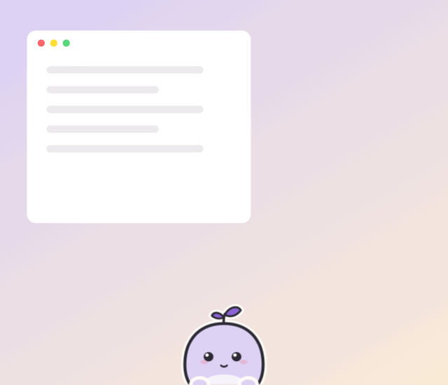
      <h3>Remembers your meetings</h3>
      From your Mac's Calendar (Google, Outlook and iCloud calendars you've added work too). Hush holds up a clock 5
      minutes before and checks its pocket watch, then holds a little door open a minute before and waits. With a Zoom, Meet, Teams or similar link, one click
      on Hush joins. It's its own window, not a notification, so Focus doesn't hide it.
    </td>
    <td width="50%" valign="top">
      
      <h3>Hand it to Hush</h3>
      Copy some text and Hush's cheeks fill up. Click it, pick <em>Simpler</em>, <em>Shorter</em> or
      <em>Bullets</em>, and it chews, then hands the result back on your clipboard. Paste, and the cheeks blow out.
      Runs on your Mac with Apple Intelligence.
    </td>
  </tr>
  <tr>
    <td width="50%" valign="top">
      
      <h3>Ask Hush, from anywhere</h3>
      Press <kbd>⌘</kbd> <kbd>⇧</kbd> <kbd>H</kbd> and ask. Quick questions come back as a card shaped to the answer,
      code questions run read-only in a repo you allowed, and long ones open in ChatGPT, Claude or Perplexity.
      Answers use your own Claude Code login.
    </td>
    <td width="50%" valign="top">
      
      <h3>Stays out of your way</h3>
      Hush ducks while you type, vanishes when you join a call, and follows or hides in full-screen apps. It's left out
      of screen shares and screenshots. Pause it from the menu bar and it pulls down a "Do not disturb" blind, or press <kbd>⌥</kbd> <kbd>⇧</kbd> <kbd>⌘</kbd>
      <kbd>H</kbd> to put away whatever it's showing.
    </td>
  </tr>
  <tr>
    <td width="50%" valign="top">
      
      <h3>Plays when it's quiet</h3>
      When you're idle and nothing is waiting, Hush perches on your windows, puffs its cheeks when you copy, bobs to
      your music and yawns in the morning. Play never interrupts you and never counts toward the daily cap.
    </td>
    <td width="50%" valign="top">
      
      <h3>Make it yours</h3>
      Three bodies, nine colours, eyes, toppers and a wardrobe of 46 pieces, all free. Now and then Hush finds
      something rare.
    </td>
  </tr>
</table>

### And a few more things

- **What I saw.** Menu bar ▸ *What I saw* lists every item Hush looked at this week, what it did and why, in plain
  words. It stays on your Mac for 7 days, and Forget empties it.
- **Tell Hush what matters.** In *What I've learned*, type it your way ("tap the glass when boss@acme.com writes").
  Apple's on-device model proposes rules and you add the ones you want. Every rule reads as a sentence you can edit,
  and rules run in code. Flicking Hush away, or *Not this kind again* on a card, teaches it too.
- **What are my agents doing?** Ask Hush "what's Claude doing?" and it answers from your sessions on this Mac, with no
  model call. "Let me know when it finishes" keeps an eye on one for you.
- **While you were away.** Come back after 10 minutes or more and Hush holds a quiet envelope listing what each Claude
  Code session did: files changed, commands, commits. Open jumps to it, Summarise sums it up. Off until you turn it on.
- **Answers go where you work.** A formula pastes into Excel, a command goes to Terminal, iTerm or Warp, notes save to
  Notion or Obsidian, code questions continue in Cursor. Nothing is pasted or run for you: it copies and tells you
  where.
- **Follow-ups and history.** Up to 3 follow-ups on an answer, then carry on in your assistant. History stays on
  your Mac until you forget it.
- **Browser tasks (beta, off by default).** Ask for something done in your browser. You see the plan first, press
  *Run it*, and it asks before anything that sends, buys, deletes or posts.
- **The held-back count.** The menu bar shows today's and this week's count: "4 shown · 63 held back". After 18:30 a
  tuck-in card says the same, and on Fridays you get the week.
- **Rare finds.** Now and then Hush turns up wearing something you've never seen, at most once a day and never while
  you're busy. Found pieces are yours to wear.
- **Kind to your battery.** In Low Power Mode or on low battery, Hush puts on a nightcap and moves less, and alerts
  still arrive. Paused, locked or in a call, it
  runs nothing.

<details>
<summary><b>See it in the app</b></summary>

<br>

Recorded from the app itself (`scripts/record-media.sh`), with simulated meetings, mail and agent sessions.

<p align="center">
  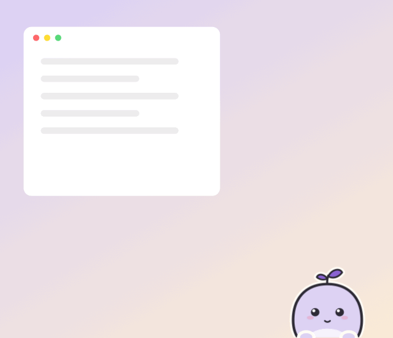
  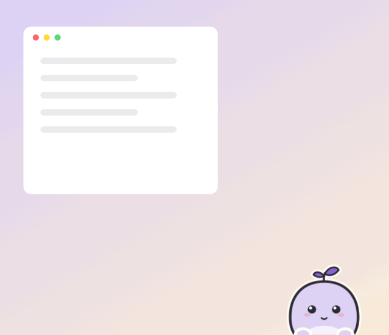
  
  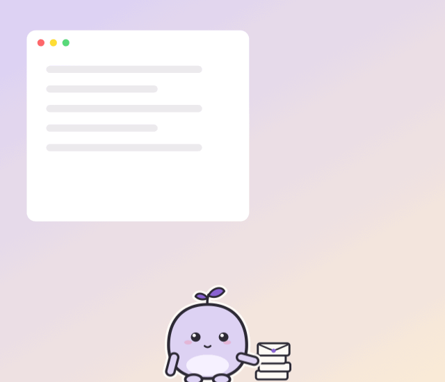
</p>

</details>

## Silent by design

- **Silent.** Body language first. No sound, no voice, no chat persona.
- **Attention is earned.** Only meeting times, VIPs and your own rules may interrupt. The model never does on its own,
  and a daily cap (5 by default) keeps it honest.
- **Respects focus.** Ducks while you type, disappears during calls, stays out of your screen shares.
- **Delight never interrupts.** Play only happens when you're idle, and it never counts toward the cap.
- **Scrutable and local.** Menu bar ▸ *What I saw* lists every item Hush looked at this week, what it did and why. It
  stays on your Mac, and Forget empties it.
- **A doorway, not a destination.** One question, one answer card, a few follow-ups, then you carry on in your own apps.
- **Light on your Mac.** About 2 to 3 % CPU when idle.

## Install

There's no signed download yet, so Hush is built from source. A Mac that builds an app runs it without Gatekeeper
warnings.

```sh
git clone https://github.com/adityasshekhawat/hush.git
cd hush
./scripts/bundle.sh        # build, install to /Applications/Hush.app, open it
```

**You need**
- macOS 15 or later
- Xcode, or the Command Line Tools with Swift 6.1 or later (`xcode-select --install`)
- Optional: Apple Intelligence on (macOS 26 or later, Apple silicon) for Hand it to Hush
- Optional: [Claude Code](https://claude.com/claude-code) for agent alerts (they use its hooks, no model calls) and for
  Ask Hush answers, which use your own Claude Code login, so there's no new account and no API key to paste

On first launch Hush says hi, lets you make it yours, and walks you through Calendar and your Claude Code sessions. Every
connection is optional, and you can skip setup at any time. If Hush quits, open it from Spotlight or run `open -a Hush`.

**Updating.** In the folder you cloned, pull and build again:

```sh
cd hush
git pull --ff-only
./scripts/bundle.sh        # rebuilds, quits the old Hush, swaps it in place, reopens it
```

Or let Hush tell you: choose **Check for updates…** in the menu bar panel's ··· menu, or say yes when it asks to
check once a day. When a new version is out, the panel shows it with an **Update** button, which opens Terminal in
the folder you built Hush from and runs those two commands, so you see each step. Nothing updates on its own.

Your Hush, wardrobe, rules and history stay as they were. If an update changes the agent hooks, Hush says so, and you
update them in Settings ▸ Connections. [CHANGELOG.md](CHANGELOG.md) lists what's new. Watch ▸ Custom ▸ Releases on
GitHub to hear about new versions.

## Things to try

| You | Hush |
| --- | --- |
| Move the cursor near | Its eyes follow you |
| Hover | Pops half out of the edge and waves |
| Press and hold | A pat. It leans into your hand |
| Click four times, fast | Dizzy, then a little grumpy |
| Drag it somewhere | Swings along, lands with a puff of dust, and lives there now |
| Flick it away | Tumbles backwards out of sight, and learns that sender can wait |
| Copy something | Cheeks puff up like a hamster. Paste lets the air out |
| Copy a paragraph, then click it | Pick *Shorter*, and paste |
| <kbd>⌘</kbd> <kbd>⇧</kbd> <kbd>H</kbd> | Ask "XLOOKUP in Google Sheets" |
| Rest the cursor on it for 20 s | Falls asleep under your hand |
| Leave it idle for two minutes | Hops onto your window and swings its legs |
| Settings ▸ What I've learned ▸ Add a rule | Just say it: "tap the glass when boss@acme.com writes" |
| Stay after 18:30 | A tuck-in card: what it showed you today, and what it held back |

## What it pays attention to

| Source | How |
| --- | --- |
| Calendar | macOS Calendar. A gentle nudge 5 minutes before a meeting, a real one a minute before. Lead times are a setting |
| Claude Code and Codex | Session hooks send the event, session id, folder, host app and terminal device. When an agent asks your permission, also the tool and up to 200 characters of what it wants to run |
| Claude Code transcripts | Opt-in, read on your Mac for the "While you were away" digest |
| Your focus | Microphone in use, full screen, typing, away |
| Copy, paste, screenshots, power, audio | Only for play. No permissions needed |
| Mail | Not yet. The judging is built and measured, but the Apple Mail extension that feeds it isn't done, so mail is only simulated for now (Settings ▸ Developer). When it lands: your VIPs and rules ("always tap the glass for mail about outage") come out right away, Apple's on-device model brings forward what looks like it needs you, gently, by sender and subject, and the rest waits for a digest at a natural break, like coming back from lunch |

## What leaves your Mac

No Hush server, no account, no analytics, no crash reporting. Everything Hush learns and logs stays in
`~/Library/Application Support/Hush/`. These are the only times anything leaves the Mac, and each one starts with
something you do:

| When you… | What's sent | Where |
| --- | --- | --- |
| Press Return in Ask Hush (quick or code question) | Your question and the name of the app you were in. For a code question, Claude Code reads files in that repo, which you allowed first | Anthropic, through **your own** Claude Code login and usage |
| Press Return when Hush isn't sure where a question should go (Smart routing, on by default, Settings ▸ Ask Hush) | Your question, your allowed repos' names, how many sessions are running, the app you're in | Anthropic, through your Claude Code login |
| Click **Summarise** on a "While you were away" card | A short excerpt of that one session | Anthropic, through your Claude Code login |
| Run a browser task (beta, off by default) | The task, and what Claude does in your browser | Anthropic, through Claude Code and the Claude browser extension |
| Hand a question off ("open in ChatGPT / Claude / Perplexity") | The question, in the link that opens | The assistant you picked |
| Choose **Check for updates…**, or say yes to checking once a day (asked once; Settings ▸ General) | A request for Hush's latest release, with Hush's version. Nothing about you | GitHub |

**Stays on the Mac:** your calendar; the agent hooks' events (over a private socket only Hush can read, kept in memory,
never written down); Hand it to Hush and mail judging, which use Apple's on-device model; transcripts for the digest
(only if you turn it on); the clipboard, which Hush reads only when you click it to rework what you copied.

<details>
<summary><b>Models, by lane</b></summary>

<br>

| Lane | Default | Used for |
| --- | --- | --- |
| Quick answers | Haiku | Short questions, answered on a card |
| Code questions | Sonnet | Read-only Claude Code runs in an allowed repo |
| Smart routing | Haiku | Deciding where an unclear question goes |
| Digest summaries | Haiku | The Summarise button on the away digest |
| Browser tasks (beta) | Sonnet | Plan and run, after you press Run it |
| Hand it to Hush, mail judging | Apple's on-device model | Runs on your Mac |

Models are settings (Settings ▸ Ask Hush). Each lane points at the newest model of its tier, so upgrades arrive on
their own. A small test set of real questions (`./scripts/swift.sh run hush-eval`) decides when a default changes.
Planned: quick answers and Summarise move to Apple's on-device model.

</details>

## Roadmap

- [x] Character, moods, antics and the wardrobe
- [x] Calendar meetings with one-click join
- [x] Claude Code and Codex: what an agent asks for, risk by rules, Open to the exact tab, the flag rail
- [x] Ask Hush: quick, repo and hand-off lanes, follow-ups, history
- [x] Hand it to Hush, on your Mac
- [x] "While you were away" digest, tuck-in card and weekly card
- [x] Pause, energy saver, and *What I saw*
- [ ] Mail, through an Apple Mail extension
- [ ] More agents
- [ ] A signed, notarized release

## Contributing

Issues and pull requests are very welcome. A good first step is to run Hush for a day and open an issue about the
moment it got something wrong. The bar for every change is restraint: it should make Hush quieter, kinder or more
useful, never louder.

Before you send a PR, run `./scripts/swift.sh test`, and keep copy plain, warm and short: Hush talks like a small
friend, not an assistant. [`CLAUDE.md`](CLAUDE.md) is the code map, [`docs/features.md`](docs/features.md) lists
everything Hush does, and [`docs/decisions.md`](docs/decisions.md) records why.

Want to draw for Hush? It needs hats, outfits, props, buddies and seasonal pieces drawn to fit its bodies. See
[`CONTRIBUTING.md`](CONTRIBUTING.md). Found a security problem? See [`SECURITY.md`](SECURITY.md).

## Show your Hush

- **Dress yours** on the [website](https://hush-two-sigma.vercel.app/#try), download its card, and post it with
  **#MyHush**.
- **Share it** in [Show and tell](https://github.com/adityasshekhawat/hush/discussions/categories/show-and-tell): your
  outfit, your desktop, the day it held back 63 things.
- **Give it a star.** Stars are how other people find Hush.
- **Draw for it.** New hats, props and seasonal pieces are welcome; see the
  [art issues](https://github.com/adityasshekhawat/hush/issues?q=is%3Aissue+is%3Aopen+label%3Aart).

## Licence

- **Code:** [Apache License 2.0](LICENSE).
- **Hush itself** (the character's shapes, faces, poses and animations, including the images above), **the name, logo
  and app icon** are reserved. Forks are welcome under their own name, icon and character.
- **Wardrobe pieces, props, effects and edge pieces** (`assets/character/swag`): [CC BY-SA 4.0](assets/character/swag/LICENSE).
  Remix them, and contribute new ones.
- Details: [`LICENSE-ASSETS.md`](LICENSE-ASSETS.md) and [`NOTICE`](NOTICE).

<br>

<p align="center">
  <picture>
    <source media="(prefers-color-scheme: dark)" srcset="docs/readme/footer-dark.svg">
    
  </picture>
</p>

<p align="center"><sub>Made by <a href="https://github.com/adityasshekhawat">aditya</a>. Hush is an independent project and isn't affiliated with Anthropic or OpenAI.</sub></p>
